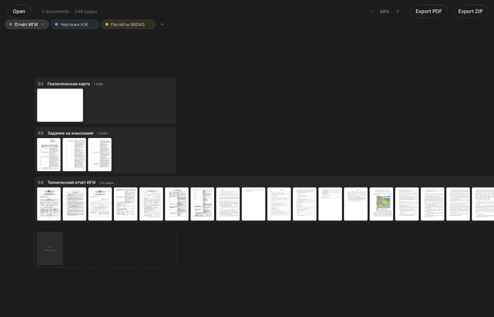
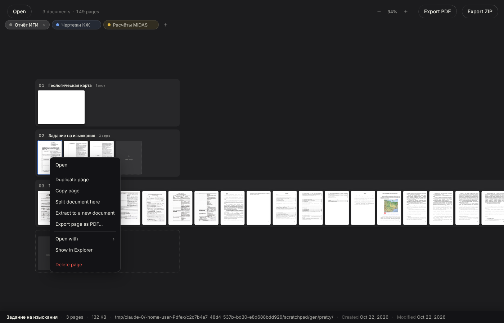
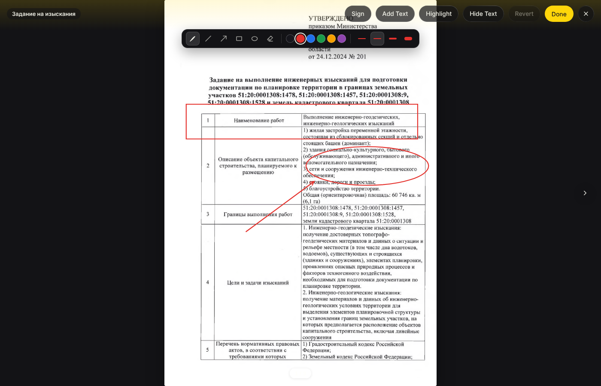
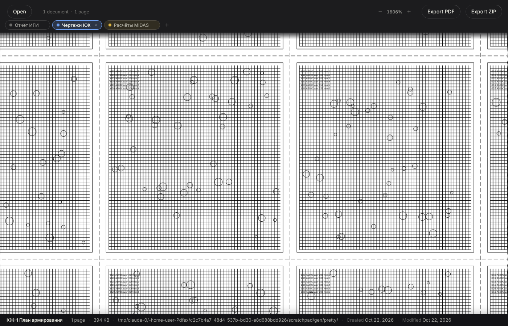

# PDFx для Windows

Быстрый переносной (portable) просмотрщик PDF для Windows с двумерным холстом,
вкладками рабочих пространств и сохранением сеансов. Удобен, когда нужно
держать открытыми одновременно отчёт ИГИ, расчёты MIDAS и чертежи КЖ.

Основан на [PDFx](https://github.com/AlexandrosGounis/pdfx) Алекса Гуниса,
часть функций перенесена из
[PDFx Plus for Windows](https://github.com/Umohammad/pdfx-plus-windows)
(подробности в [NOTICE](NOTICE)).



## Запуск

1. Скачайте `PDFx-Windows-Portable.zip` (раздел **Actions → Windows Portable →
   Artifacts** или страница выпуска).
2. Распакуйте в любую папку, в том числе на флешку.
3. Запустите `pdfx.exe`.

Установка, права администратора и интернет не нужны. При первом запуске
Windows SmartScreen может предупредить о неподписанной программе:
«Подробнее» → «Выполнить в любом случае».

Настройки и автосохранённый сеанс лежат в папке `data` рядом с `pdfx.exe`.
Чтобы перенести программу вместе с открытыми вкладками, скопируйте папку
целиком. Если в папку программы нельзя писать, данные сохраняются в
`%APPDATA%\PDFx`, и программа один раз предупреждает об этом.

## Обновления

Программа сама проверяет новую версию раз в сутки (и по **Help → Check for
Updates**). Новая версия скачивается, проверяется по контрольной сумме и
заменяет файлы программы при перезапуске или закрытии; папка `data` с
сеансом и настройками остаётся. Прежнюю версию можно вернуть в **About**.
Если в интернет пускают только браузер, PDFx предложит скачать архив в
браузере и сам найдёт его в «Загрузках». Подробности и выпуск новых версий:
[docs/UPDATES.md](docs/UPDATES.md).

## Настройки и справка

**File → Settings** (Ctrl + ,) или шестерёнка справа от вкладок:

- колёсико мыши прокручивает холст (как раньше) или масштабирует, как в
  CAD-программах;
- открывать ли вкладки прошлого сеанса при запуске;
- язык распознавания текста по умолчанию;
- чем конвертировать документы Office: Microsoft Office или LibreOffice;
- проверка обновлений и канал (стабильные выпуски или все сборки);
- папка данных.

**F1** — справка с описанием возможностей и списком клавиш, кнопка «?» —
**About**: версия, авторы, лицензии, проверка обновлений и возврат
предыдущей версии.

## Управление холстом

| Действие | Мышь / клавиатура |
|---|---|
| Прокрутка вверх-вниз | колёсико (в настройках можно переключить на масштаб) |
| Прокрутка влево-вправо | Shift + колёсико |
| Масштаб относительно курсора | Ctrl + колёсико, щипок на тачпаде |
| Перемещение холста | зажатая средняя кнопка (в любом месте) или левая по пустому месту |
| Вписать в окно | Ctrl + 0 или щелчок по проценту масштаба |
| Открыть страницу на весь экран | двойной щелчок |

Колёсико мыши двигает и масштабирует плавно, тачпад — непрерывно, как в Figma.

## Документы и страницы

- **Правый щелчок по странице**: открыть, дублировать, копировать, разделить
  документ, извлечь в новый документ, экспортировать страницу, открыть во
  внешней программе, показать в Проводнике, удалить.
- **Правый щелчок по документу**: дублировать, заменить другим файлом,
  экспортировать, перенести в другую вкладку, открыть во внешней программе,
  показать в Проводнике, удалить.
- **Выделение**: Ctrl + щелчок добавляет страницу, Shift + щелчок выделяет
  диапазон, Ctrl + A выделяет всё. Меню по выделению действует на все
  выделенные страницы.
- **Перетаскивание страницы** переносит её; с зажатым Ctrl — копирует вместе
  с пометками (в другой документ или в новый, если отпустить между
  документами).
- **Номер документа** (01, 02…) можно перетащить в Проводник: получится PDF-файл.
- При наведении на документ внизу показываются имя, число страниц, размер,
  папка и даты файла.
- **Export PDF** спрашивает, какие документы включить.
- Любое изменение отменяется Ctrl + Z, повторяется Ctrl + Y.



## Документы Word, Excel, PowerPoint

Поддерживаются современные и старые (97–2003) форматы, шаблоны, файлы с
макросами и показы:

- Word: `.docx`, `.doc`, `.docm`, `.dotx`, `.dot`, `.dotm`, `.odt`;
- Excel: `.xlsx`, `.xls`, `.xlsm`, `.xlsb`, `.xltx`, `.xlt`, `.xltm`, `.ods`;
- PowerPoint: `.pptx`, `.ppt`, `.pptm`, `.ppsx`, `.pps`, `.potx`, `.pot`, `.odp`.

Их можно перетащить на холст, открыть через **Open** или на `pdfx.exe`. Они
превращаются в PDF средствами установленного на компьютере Microsoft
Office (лучшее совпадение с оригиналом), а без него — LibreOffice. Ничего не
скачивается и не отправляется в интернет; макросы отключены. Дальше с
документом можно работать как с любым PDF и сохранить его через **Export
PDF** или «Export document as PDF…». Если нет ни Office, ни LibreOffice,
программа так и скажет.

## Открытие файлов

- **Settings → PDF files → Open PDFs in PDFx** (Windows): PDFx появляется в
  «Открыть с помощью» и в меню Проводника («Open in PDFx»), файлы `.pdfx` и
  `.pdfxs` открываются в нём. Пишется только для вашей учётной записи (без
  прав администратора), снятие галочки всё удаляет. Кнопка **Make default…**
  открывает страницу Windows, где PDFx можно сделать программой для PDF по
  умолчанию (это Windows разрешает только самому пользователю). Если папку
  программы перенесли, путь обновляется при следующем запуске.
- **File → Open Recent** — последние открытые файлы; в Windows они же в
  списке переходов на панели задач.
- **PDF с паролем** спрашивает пароль при открытии (повторно — при неверном).
  Пароль хранится только в памяти; экспортированные копии без защиты.
  Экспорт зашифрованных PDF (в том числе тех, что открываются без пароля,
  но запрещают печать или правку) раньше давал пустые страницы — теперь
  PDFx сам снимает шифрование при экспорте: RC4 40/128, AES-128 и AES-256.

## Режим чтения

Двойной щелчок по странице открывает её на весь экран. Страницы идут
сверху вниз, как в других читалках: колесо мыши листает по странице за
щелчок, тачпад прокручивает плавно, после последней страницы документа
идёт первая страница следующего.

- Кнопки рядом с названием: **по одной странице**, **прокрутка по ширине
  окна** или **по две страницы рядом**. В режимах прокрутки Ctrl + колесо
  масштабирует относительно курсора. Для рисования (Edit) страница
  показывается одна, после Done возвращается выбранный режим. Выбор
  запоминается.
- **F4** — боковая панель: миниатюры, оглавление (закладки PDF) или
  **слои** чертежа (Layers), если они есть. Скрытые слои не видны на холсте,
  в режиме чтения и при сравнении; в экспорте они остаются, но выключены,
  поэтому не печатаются.
- При повторном открытии файла PDFx предлагает продолжить чтение с той
  страницы, на которой вы остановились.
- Номер внизу («12 / 340») можно ввести с клавиатуры и нажать Enter;
  **Home** и **End** — первая и последняя страница; ↑ ↓ и ← → — соседние.
- Ссылки работают: внешние открываются в браузере, внутренние (оглавление,
  ссылки на литературу) переходят к странице.
- Текст выделяется мышью и копируется Ctrl + C.
- **Print** (Ctrl + P) печатает документ или текущую страницу через
  стандартный диалог Windows вместе с пометками; каждая страница идёт на
  лист своего формата.
- **Повернуть** страницу можно кнопками ⟲ ⟳ в режиме чтения и клавишами
  **Ctrl + Shift + «+»** (вправо) и **Ctrl + Shift + «−»** (влево) — в
  режиме чтения поворачивается открытая страница, на холсте — выделенные
  (работает в любой раскладке и на цифровом блоке). Выделение или документ
  поворачиваются и через контекстное меню.
  Поворот виден везде, сохраняется в сеансе, отменяется Ctrl + Z и
  попадает в экспорт и печать. Пометки на повёрнутой странице не
  рисуются: сначала верните её в исходное положение.

## Вкладки и сеансы

- Ctrl + T — новая вкладка, Ctrl + W — закрыть, Ctrl + Tab — следующая.
  Двойной щелчок по вкладке переименовывает её, правый щелчок открывает
  цвет и «Сохранить вкладку как…».
- У каждой вкладки свои документы, пометки, масштаб, положение холста и
  история отмены.
- Всё сохраняется автоматически через секунду после изменения и при
  закрытии окна. После перезапуска или аварийного завершения программа
  открывается в том же состоянии.
- **File → Save Session As…** (Ctrl + Shift + S) сохраняет все вкладки в
  файл `.pdfxs`. Открытие такого файла добавляет его вкладки.
- Исходные PDF не копируются: в сеансе хранится путь к файлу. Копируются
  только данные, которых нет на диске (вставленные изображения,
  сконвертированные файлы).
- Если файл переместили, в сеансе появится уведомление с кнопкой
  «Locate…»: укажите файл на новом месте, и страницы вернутся на прежнее
  место. Если файл изменили в другой программе, PDFx предложит
  «Reload».
- Исходные PDF никогда не изменяются: пометки сохраняются в сеансе, а в PDF
  попадают только при экспорте.

## Пометки

Двойной щелчок по странице → **Edit**. Доступны инструменты оригинала
(подпись, текст, выделение, скрытие текста) и панель рисования: перо,
линия, стрелка, прямоугольник, эллипс и ластик, шесть цветов и четыре
толщины. Shift выравнивает линии по 45° и делает прямоугольник квадратом,
а эллипс кругом. При экспорте пометки становятся обычной векторной графикой
PDF и видны в любом просмотрщике.



## Измерения на чертежах

В режиме **Edit** есть три инструмента-линейки: длина, ломаная и площадь.
Длина — протяните мышью; у ломаной и площади щёлкайте по точкам и
закончите двойным щелчком или Enter (Backspace убирает последнюю точку,
Esc отменяет). Масштаб чертежа (1:1…1:5000) и единицы (мм, см, м)
выбираются на панели; для листа без известного масштаба есть
**Calibrate**: проведите размер, длину которого знаете, и введите её.
Подписи («8,4 м», «12,6 м²») экспортируются текстом и находятся поиском в
любом просмотрщике.

## Выноски и оформление текста

- **Callout** — выноска: протяните стрелку от точки на листе и введите
  текст в рамке. Двойной щелчок редактирует текст, выноску можно двигать.
- У текста выбираются шрифт (без засечек, с засечками, моноширинный),
  жирность, размер и цвет; выделите добавленный текст, чтобы изменить его
  оформление.
- Выделение текста PDF бывает заливкой шести цветов, подчёркиванием и
  зачёркиванием.

## Комментарии

Комментарий — это не пометка на листе, а заметка-обсуждение, как в
Acrobat или Word:

- **F6** или кнопка с облачком открывает панель комментариев документа.
  **New**, затем щелчок по странице ставит в это место пронумерованную
  метку.
- На комментарий можно ответить, его можно изменить, удалить и
  **закрыть** (Resolve): закрытые скрываются со страницы и из списка
  (галочка **Show resolved** показывает их снова). Кнопка с глазом
  скрывает все метки.
- Число открытых комментариев видно на миниатюре страницы.
- Комментарии хранятся в сеансе, а при экспорте становятся стандартными
  примечаниями PDF с ответами (`/IRT`) и статусом «Completed» для
  закрытых. Acrobat, Foxit и браузеры показывают их как ветку обсуждения;
  на сам лист ничего не наносится.
- Имя автора задаётся в **Settings → Comments** (по умолчанию — имя
  пользователя Windows).
- **Комментарии из других программ.** Примечания и комментарии к выделениям,
  оставленные в Acrobat, Foxit и т. п., появляются в той же панели с
  ответами и статусом («Completed» — закрыт). На них можно ответить и
  закрыть; в файле они остаются как были, новые ответы привязываются к ним,
  дублей не появляется. Чужой текст здесь не редактируется и не удаляется.
- **Settings → Export**: пометки и рисунки можно сохранять не в сам лист, а
  как аннотации, которые в Acrobat и других программах можно выделить,
  сдвинуть или удалить (вид не меняется). Скрытый текст всегда вжигается в
  страницу.

## Сравнение редакций

Выделите две страницы (Ctrl + щелчок), щёлкните правой кнопкой и выберите
**Compare the 2 pages**. Страница, стоящая раньше на холсте, считается
старой редакцией. Удалённое показано красным, добавленное — синим, общее —
серым. Клавиши 1, 2, 3 переключают разницу, старый и новый лист; стрелки
сдвигают новый лист, если его вывели со смещением (Shift — по 10
пикселей); колесо масштабирует, двойной щелчок вписывает лист. Листы
разного размера вписываются друг в друга.

## Поиск и OCR

Ctrl + F ищет по всем документам вкладки. Сканы распознаются локально, без
интернета, после первого открытия поиска. По умолчанию язык «Russian +
English». Буквы «ё» и «е» при поиске не различаются.

При экспорте сканы распознаются (если это ещё не сделано) и получают
невидимый текстовый слой: в сохранённом PDF можно искать и копировать
текст в любой программе. Страницы со скрытым текстом (Hide Text) слоя не
получают, чтобы распознавание не вернуло скрытое. Отключается в
**Settings → Search**.

## Крупные чертежи

Во время движения холста показывается уже готовое изображение. После
остановки видимая часть страницы перерисовывается в полном разрешении, так
что листы А1–А0 читаются до мелких надписей (масштаб до 9000%).



## Известные ограничения

- Интерфейс программы на английском языке; документы, имена файлов, поиск и
  OCR полностью поддерживают русский.
- Программа не подписана цифровой подписью, поэтому SmartScreen и некоторые
  антивирусы могут предупреждать при первом запуске.
- Очень тяжёлые листы (например, карта 38×42″ с растровым рельефом) PDF.js
  в первый раз отрисовывает около 10 секунд и держит в памяти около 1 ГБ,
  пока лист на экране.
- Плавность измерена в контейнере с программной графикой (30–60 кадров/с);
  на Windows с видеокартой она выше, но на конкретных машинах её стоит
  проверить вручную.
- Отменить действие после перезапуска нельзя: история отмены живёт в
  пределах сеанса работы.
- Печать идёт растром 150 dpi: этого достаточно для чтения мелкого текста
  на А4–А3, но это не векторная печать.
- Боковая панель накрывает левый край широкой страницы, а не сдвигает её.
- Документы Office конвертируются при открытии; изменения исходного .docx
  или .xlsx потом не отслеживаются — откройте файл заново. Нужен
  установленный Microsoft Office или LibreOffice.

Полный отчёт о проверках: [docs/TEST-REPORT.md](docs/TEST-REPORT.md).
Изменения относительно оригинала: [CHANGES-WINDOWS.md](CHANGES-WINDOWS.md).

## Сборка из исходников

```sh
yarn install
yarn typecheck && yarn test        # проверка типов и юнит-тесты
yarn electron-vite build
yarn e2e                           # сценарии на собранном приложении (Linux: xvfb-run -a yarn e2e)
yarn electron-builder --win        # dist/PDFx-Windows-Portable.zip
node scripts/verify-portable.mjs   # комплектность сборки
```

Сборка ZIP для Windows запускается в GitHub Actions при пуше в ветку
`windows-build` и для pull request в `main`. Выпуск с обновлением для
пользователей — workflow **Release**, см. [docs/UPDATES.md](docs/UPDATES.md).

Описание исходного проекта PDFx: [docs/UPSTREAM-README.md](docs/UPSTREAM-README.md).

## Лицензия

MIT, см. [LICENSE](LICENSE) и [NOTICE](NOTICE).
